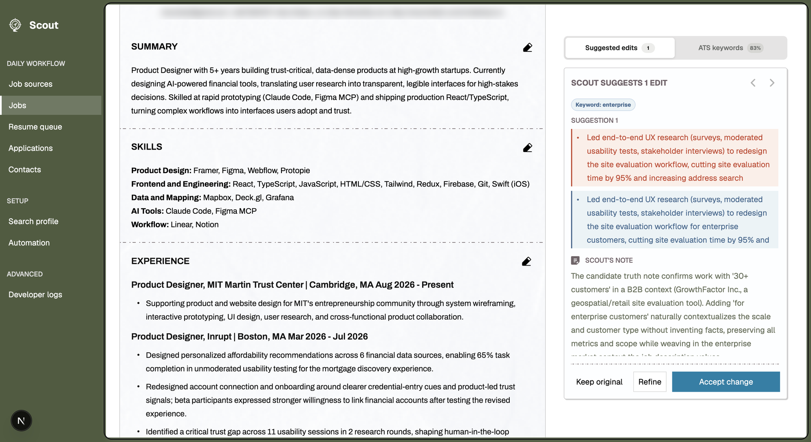
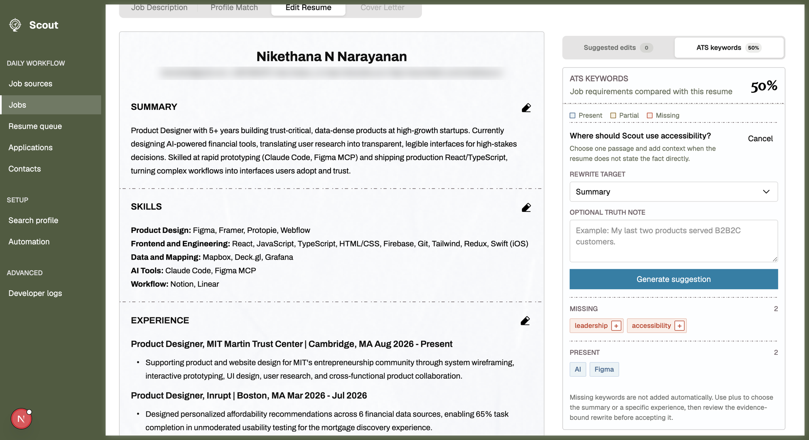
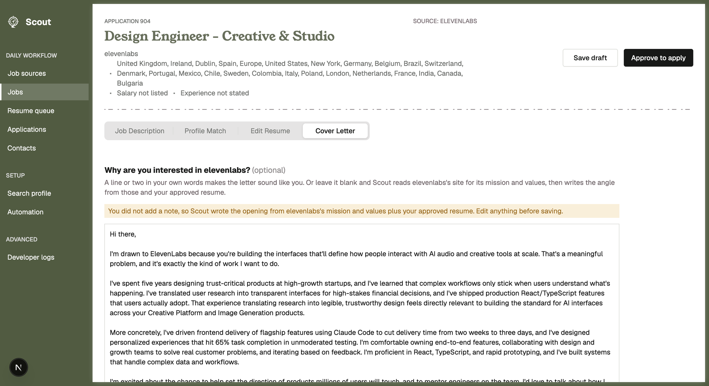

# Scout

Scout is a private job search app for one candidate. It collects jobs, scores them against your profile, tailors resume drafts using only facts you have confirmed, researches contacts, and tracks applications through to an outcome.

Everything runs on your own machine against a local SQLite file. Nothing leaves it except requests to the AI and search providers you choose to configure.

## Screenshots

**Suggested edits.** Scout proposes truthful rewrites for a job, grounded in your truth bank, and explains each one.



**ATS keywords.** See which job requirements your resume covers, and ask for a rewrite that adds a missing one.



**Cover letter.** A draft written from the company's mission and your approved resume, ready to edit.



## Quick start

You need Node.js 22 LTS and pnpm 9 (`corepack enable` installs the right pnpm). Scout runs anywhere Node does; automatic scheduled collection needs macOS.

```bash
git clone https://github.com/Nikethana-Nagasubramanian/scout.git
cd scout
pnpm install
cp .env.example .env
pnpm dev
```

Open [http://localhost:3000](http://localhost:3000). No API keys are needed to get this far.

## Where to start

A fresh install opens on the **Search profile** page, and every other page sends you back there until the profile is saved.

1. **Upload your resume.** Import a PDF, DOCX, or text file, or paste the text. Scanned PDFs have no text layer, so paste those instead.
2. **Review the truth bank.** The first import turns your resume bullets into facts. Remove anything inaccurate and add achievements the resume leaves out. Tailored resumes can only use facts in the truth bank, so this is what keeps them honest.
3. **Set your search and save.** Target roles, seniority, years of experience, locations, and sponsorship needs decide which jobs Scout keeps and why others are filtered.
4. **Choose an AI provider** on the Automation page. See [AI setup](#ai-setup) below. Without one, Scout still works and uses templates for drafts.
5. **Add companies you want to watch** (optional). On Job sources, paste a company's careers page or any of its job links. Scout finds its Greenhouse, Ashby, or Lever board and checks it works.
6. **Fetch jobs.** Click Fetch new jobs on the Jobs page. Remotive, Jobicy, and Himalayas work with no keys.
7. **Prepare an application.** Open a job worth your time and prepare it. The tailored resume lands in the Resume queue for review, and approved roles move to Applications.

## API keys

Every key is optional. Put the ones you want in `.env`, which git ignores, and restart `pnpm dev`.

| Key | Where to get it | What it turns on | Cost |
| --- | --- | --- | --- |
| `ANTHROPIC_API_KEY` | [console.anthropic.com](https://console.anthropic.com/settings/keys) | Claude for resume suggestions and cover letters. Recommended. | Well under a cent per application on Haiku |
| `EXA_API_KEY` | [dashboard.exa.ai](https://dashboard.exa.ai) | Finding companies hiring for your role before they reach job boards | Under a dollar a month |
| `HUNTER_API_KEY` | [hunter.io/api-keys](https://hunter.io/api-keys) | Finding a contact for a shortlisted role | Free tier available |
| `SCOUT_GMAIL_ADDRESS`, `SCOUT_GMAIL_APP_PASSWORD`, `SCOUT_GMAIL_LABEL` | [Google app passwords](https://myaccount.google.com/apppasswords) (needs 2-step verification) | Reading job alert emails from one Gmail label | Free |

A sensible first setup is just `ANTHROPIC_API_KEY`. Add the others once the basic loop works for you.

## AI setup

Scout uses AI to prioritize resume evidence, suggest truthful rewrites, and draft cover letters. Pick a provider on the Automation page. Scout tries them in this order and never blocks on one that is unavailable:

1. **Claude API**, when `ANTHROPIC_API_KEY` is set. Fastest and best writing. It sends the job posting and your resume evidence to Anthropic. The default model is `claude-haiku-4-5`, changeable on the Automation page.
2. **Ollama**, when it answers a quick reachability check. Free and fully private, but slower and less reliable on small models.
3. **A deterministic template**, which is instant and always available.

The line under each cover letter names which one produced it.

### Local Ollama

Use Ollama if you want nothing to leave your machine or do not want to pay for an API.

1. Install it from [ollama.com/download](https://ollama.com/download), or `brew install ollama` on macOS.
2. Pull the default model. `gemma3:4b` needs about 4 GB of free memory and is the tested default:

   ```bash
   ollama pull gemma3:4b
   ```

   With 16 GB of memory or more, a larger model such as `gemma3:12b` writes better but is slower.
3. Start the server and leave it running:

   ```bash
   ollama serve
   ```

4. On the Automation page, set Provider to **Ollama on this Mac** and pick the model you pulled.

If `ollama serve` is not running, Scout silently falls back to the template, so check the line under a draft. Set `OLLAMA_URL` in `.env` if Ollama is not on `http://127.0.0.1:11434`.

## How job discovery works

Scout works for any role, not just design. Everything it searches for comes from the target roles in your Search profile.

**Sources.** A fresh install starts with only the three public feeds. You add the rest:

| Source | How to add it |
| --- | --- |
| Remotive, Jobicy, Himalayas | Built in. Each request searches one of your target roles. |
| Company boards (Greenhouse, Ashby, Lever) | Job sources page: paste a careers page, a job link, or a board name. Scout also adds boards it spots in fetched jobs, Exa results, and discovery pages. |
| Discovery pages | Job sources page: paste a VC portfolio or company directory. Scout reads it daily for company boards. |
| Exa | Set `EXA_API_KEY`. Searches are generated from your target roles. |
| Gmail | Set the `SCOUT_GMAIL_*` keys and send job alerts to that label. |

**Matching.** A job matches when its title contains every word of a target role ("Senior Software Engineer, Payments" matches Software Engineer), and is kept for review when it shares half of them. Lead, staff, manager, and director titles are filtered unless your target roles or seniority include them. Design searches get extra rules: other design disciplines and hardware roles are filtered, and design-adjacent titles are kept for review when the description reads like product design.

**Schedule.** A board that produces an eligible role is checked hourly. After 3 empty checks it drops to daily, and after 8 to weekly. Boards are never deleted, so a company that starts hiring again recovers on its own.

Every fetched result is saved. Open a fetch in Jobs to see which roles passed, which were filtered, and why.

## What each page does

| Page | Purpose |
| --- | --- |
| Job sources | Everywhere Scout looks and how often: Exa queries and remaining credit, public feeds, your Gmail label, and every official board grouped by check frequency. |
| Jobs | Every collected job, its score, and the fetch result explaining why it passed or was filtered. |
| Resume queue | Review tailored resumes. Approve, regenerate, or reject a draft. |
| Applications | Track submitted applications, follow-ups, and outcomes. Download a backup here. |
| Contacts | Find an evidence backed contact for a shortlisted role before you apply. |
| Search profile | Your resume, truth bank, and search preferences. The source of truth for matching and resume generation. |
| Automation | Collection times, AI provider, and model. |
| Developer logs | Per fetch step logs, timings, and counts for debugging a collection run. |

## Resume workflow

Prepare a job from the Jobs page to generate a tailored resume draft. Drafts land in the Resume queue, where each version can be expanded, regenerated, approved, or rejected. Approving a resume moves the role forward into Applications. Scout keeps earlier versions so you can compare what changed, and never lets a model invent resume claims.

## Ollama performance notes

Roughly a third of a cold local request is the model loading from disk. When Ollama is the chosen provider, Scout keeps the model loaded for 30 minutes. When it is only the fallback, the model is released after each request so it does not hold memory. Override either with `OLLAMA_KEEP_ALIVE`.

To let resume suggestions run in parallel, start the server with `OLLAMA_NUM_PARALLEL=4 ollama serve`, which was about 17 percent faster in testing. Using one model for every task avoids reloads.

Ollama has no internet access, so everything it knows comes from the job posting Scout fetched and your truth bank.

## Gmail hiring signals

Scout can read job alert email to pull out specific roles and find new company job boards to check. Configure it with these environment variables:

```text
SCOUT_GMAIL_ADDRESS
SCOUT_GMAIL_APP_PASSWORD
SCOUT_GMAIL_LABEL
```

Use a Google app password, not your account password. Run a manual pass with:

```bash
pnpm collect:gmail
```

## Contact research

The Contacts page uses Hunter to find an evidence backed contact for a role. Set `HUNTER_API_KEY` to enable it. Scout tracks credit usage against a budget and shows the remaining allowance on the page. Without the key the page still lists opportunities, but cannot run a lookup.

## Company discovery with Exa

Scout uses [Exa](https://exa.ai) to find companies that are hiring for your role but are not
yet on any board it tracks.

Daily queries run at most once a day against the known ATS hosts
(`jobs.ashbyhq.com`, `jobs.lever.co`, and both Greenhouse board domains), looking back 30
days. Those results are job postings whose board is already named in the URL, so Scout reads
the board straight from the link without crawling anything.

One broader query runs weekly with no domain filter, to catch companies whose careers page
sits outside those hosts. Only that query leads to page inspection.

Exa is a semantic search engine, so the queries are written as plain descriptions of the
wanted role. Domain filtering is a request parameter rather than query syntax, and Scout
never asks Exa to judge fit: scoring happens afterwards against the full job text. Results
are deduplicated by canonical URL before anything is fetched, and a query that keeps
returning nothing is run less often rather than deleted.

The queries are generated from your target roles: one daily query per role (up to four) plus one weekly open-web query. They are rebuilt whenever you save the Search profile or Automation settings.

Set the key in `.env`:

```text
EXA_API_KEY=your-key-here
```

At Exa's current search price this costs well under a dollar a month. Exa reports the exact
price of every request, so Scout keeps a running total rather than an
estimate. The default budget is 10 dollars and can be changed with the `exa_budget_dollars`
setting. Once spending passes 80 percent of it, the Job sources page shows a warning banner
with the amount used, and Scout keeps searching. If Exa reports that the credits are gone,
discovery pauses and the banner says so.

Scout works without Exa. Company discovery is simply skipped when the key is missing.

## Automatic job collection

Set your preferred times on the Automation page, then install the macOS scheduler once:

```bash
pnpm scheduler:install
```

Remove it with:

```bash
pnpm scheduler:remove
```

Run a collection by hand at any time with `pnpm collect`.

## Experimental newsletter opportunities

Open **Newsletters** in Scout's sidebar to enter a public issue link or paste the issue
text. Scout discovers companies, creates an initial belief, then investigates **every
detected company**, including funding-only mentions. It uses your saved Search profile
and a conservative policy: relevant target market, product-market fit, growth, design
capacity or explicit design hiring, company scale, and visa/role eligibility assessed
separately. Edit **Your research preferences** in the app; preferences persist between runs.

The agent chooses among `inspect_company_site`, `inspect_team`, `inspect_careers`,
`inspect_product`, `search_recent_news`, and `stop`. It can discover relevant links,
read a selected page, reassess evidence, revise its hypothesis and confidence, then
choose another action or stop. Each action is one discovery search or one page read.
The balanced default is **at most five actions per company**; the final assessment
always sees the last action's evidence. Research stops sooner when the conclusion is
well supported, contrary evidence makes the opportunity weak, or further research has
little value.
An unresolved company receives at least one site inspection/discovery attempt before
stopping; explicitly irrelevant companies can stop from attributed newsletter evidence.
Repeated targets are blocked. Two consecutive tool failures stop a company
with unresolved uncertainties; an invalid model response gets at most one correction.

Each company retains `company`, `known_facts` (exact source quotes with IDs),
`current_hypothesis`, `confidence`, `unknowns`, and `research_history`. The record also
includes criterion assessments, sources, an opportunity brief, and a `pursue`, `watch`,
or `pass` verdict. History records the key uncertainty, chosen action, expected information
gain, whether it was worth taking, the result/error, and the belief before and after.
Confidence describes the conclusion, not a probability of hiring. Unknown design capacity
is not evidence of no designers. Funding alone does not establish product-market fit;
security/defense alone does not establish a citizenship restriction.

Only supported opportunities enter the shortlist, up to five by default. Identity, target
market, adoption/product-market fit and growth must be supported, together with a design
gap or design hiring signal. An evidenced visa conflict or unsuitable company scale blocks pursuing. Eligibility
unknowns remain visible and cap a positive conclusion at MEDIUM confidence. Confidence ranks the shortlist, followed by confirmed design gaps and suitable company scale. Watch/pass
records are retained and displayed, even when the shortlist is empty.

Start the app with `pnpm dev`, then visit `/newsletters`. The app launches a local Node
worker and saves each research checkpoint in Git-ignored
`data/generated/newsletters/runs/`. Progress and the latest run survive closing/reloading
the page; one app investigation runs at a time. An interrupted worker is reported as failed,
with any completed records retained. Download all company records as JSON from the app.
Your profile needs strengths or a professional summary. Saved work authorization and
sponsorship requirements are passed to the agent; unknown authorization stays unknown.

In a terminal, run `pnpm newsletter` to be asked for a newsletter link or text-file path,
or pass either directly:

```bash
pnpm newsletter "https://example.com/newsletter/issue"
pnpm newsletter issue.txt --max-actions 5 --top 3
pnpm newsletter issue.txt --criteria my-research-criteria.txt --profile my-profile.json
```

The CLI shares the same loop and saved app policy. `--max-actions` accepts 1 through 10.
`--criteria` supplies your plain-text criteria for that run. `--profile` overrides the
candidate context; optional `workAuthorization` and `sponsorshipRequired` supplement
`targetRoles`, `strengths`, and `summary`. Progress goes to stderr. Checkpoints and final
records go to `data/generated/newsletters/` or the `--output path.json` destination.
Use `--provider anthropic|ollama` and `--model MODEL` to override the configured AI.

Web search uses Exa when `EXA_API_KEY` is configured, respecting Scout's remaining local
Exa budget. Otherwise the configured Claude provider uses its native web search, limited
to one search per action. Claude web search must be enabled for the API account. An
Ollama-only run without Exa can inspect observed issue/company links, but cannot discover
new pages through search; unavailable actions are recorded honestly. Search excerpts are
labeled separately from read pages. Native Claude searches retain source-cited excerpts,
never uncited generated summaries. Provider calls incur the provider's usual API charges.

Public HTML and plain-text input are supported, with DNS-checked, pinned public addresses,
bounded downloads/redirects, and timeouts. Blocked, paywalled or JavaScript-only pages may
require pasted issue text or leave research incomplete. Company page text is capped at
18,000 characters and truncation is recorded. Quote checks prove textual presence, not
truth or correct interpretation. Extraction and judgments still depend on the model;
review decisive sources and the retained unknowns. Scout does not contact companies or
send outreach.

### Files and model instructions

- `lib/newsletter-research-prompts.ts`: the agent's evidence, action-selection and stopping instructions.
- `lib/newsletter-research-models.ts`: state, action schemas and default personal criteria.
- `lib/newsletter-research.ts`: investigation loop, quote validation, budgets and conservative shortlist gates.
- `lib/newsletter-research-evidence.ts`: stable source passages; the agent selects passage IDs and Scout copies their exact text.
- `lib/newsletter-research-tools.ts`: public page reads and Exa/Claude search adapters.
- `lib/newsletter-input.ts`: newsletter/page reader and observed links; do not weaken the public-address checks.
- `lib/newsletter-research-store.ts` and `scripts/newsletter-worker.ts`: persisted app runs and background worker.
- `lib/newsletter-profile.ts`: candidate fit and authorization context, without contact details or full resume.
- `components/NewsletterWorkspace.tsx` and `app/newsletters/`: inputs, live progress, criteria and company records.
- `scripts/newsletter.ts`: terminal prompting and checkpointed execution.
- `lib/newsletter.ts`: company extraction and the original newsletter-only assessment prompts.

### Evaluate the newsletter-only baseline

`--initial-only` runs the original extraction/inference/ranking pipeline without company
research. Its schemaVersion 1 output is distinct from the agent's schemaVersion 2 company
records. The existing synthetic evaluation intentionally tests this baseline, so fictional
companies do not trigger live searches:

```bash
pnpm newsletter examples/newsletter/issue.txt --initial-only --profile examples/newsletter/profile.json
pnpm newsletter:eval examples/newsletter/evaluation.json --profile examples/newsletter/profile.json --output data/generated/newsletters/evaluation.json
pnpm newsletter:eval examples/newsletter/evaluation.json --results data/generated/newsletters/evaluation.json
pnpm exec vitest run tests/newsletter.test.ts tests/newsletter-research.test.ts
```

Evaluation labels are withheld from prompts. Reports include strict precision
(interesting / returned), useful precision (interesting or maybe / returned), and missed
interesting companies. Empty shortlists have null precision. This is a synthetic baseline,
not a quality benchmark for the new research loop. Input is limited to 60,000 characters
and extraction uses paragraph chunks; a mention spanning a chunk boundary can be missed.
Validate the agent on real issues and review your own pursue/watch/pass judgments before
relying on its prioritization.

## Data

Your profile, jobs, resumes, and applications are stored locally in:

```text
data/job-copilot.sqlite
```

Use the Applications page to download a backup.

## Check the app

```bash
pnpm verify
```

This runs the em dash check, TypeScript, ESLint, the Vitest suite, and a production build. Note that the em dash check rejects the `U+2014` character anywhere in the tracked source, README included.
